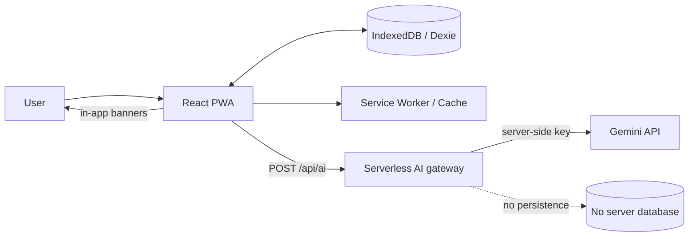
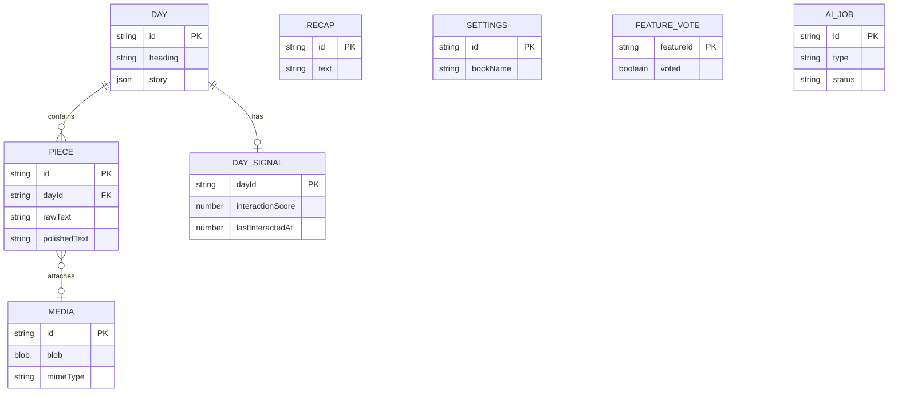
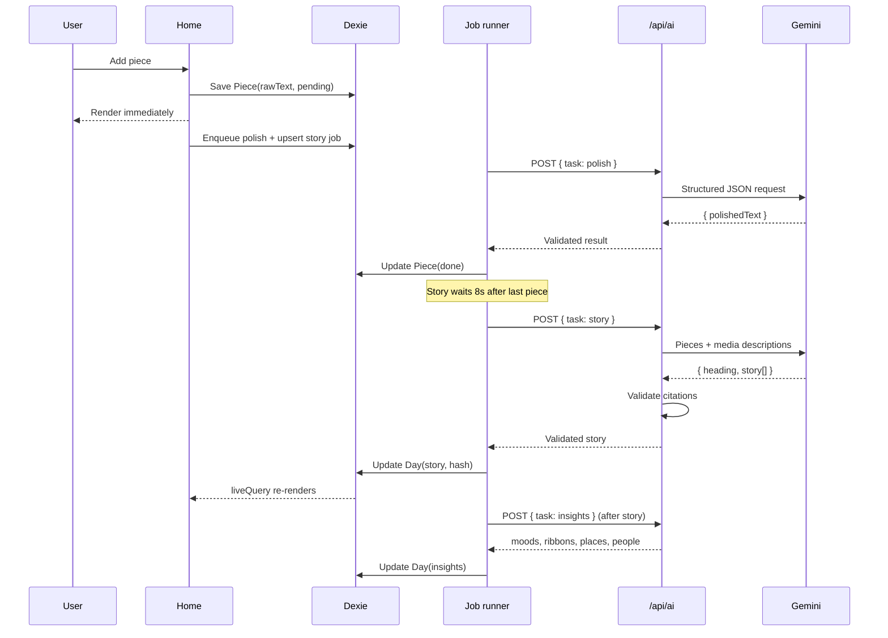

# DayBook — System Architecture

> Status: Draft v1
> Sources: `problemStatement.txt`, `idea.txt`, `Stitch Screens/DESIGN.md`
> Related: `docs/PRD.md`, `docs/implementation/README.md`
> Product: DayBook — a local-first daily diary. Capture in pieces, get a polished page and a one-page story, and never lose the raw words.

---

## 1. Architecture at a glance

| Concern | Decision |
|---|---|
| App shell | Vite + React + TypeScript single-page app |
| Styling | Tailwind CSS + CSS custom properties from `DESIGN.md` |
| Local persistence | IndexedDB via Dexie (`dexie-react-hooks` for live reads) |
| Offline | PWA via `vite-plugin-pwa` (Workbox) |
| AI custody | One serverless route: `POST /api/ai` (Vercel function) |
| AI provider | Gemini free tier behind a provider interface |
| Contracts | Zod schemas shared by client and server |
| Job orchestration | Client-side persisted queue in Dexie with debounce, dedupe, backoff |
| Memory surfacing | Local readiness + salience model; progressive unlock, no single fixed day threshold |
| Hosting | Vercel free tier (static CDN + one serverless function) |
| Testing | Vitest + `fake-indexeddb`, Playwright, mocked AI contract tests |
| Privacy posture | No server database, no accounts; key stays server-side |

**Core rule:** the browser owns all user data. The server is a stateless, key-holding AI proxy. IndexedDB is the system of record, and the raw piece text is immutable.

**Memory rule:** memories are earned from accumulated history and interaction, not from a fixed number of days. Readiness and salience are computed locally and are never shown as metrics, progress bars, or streaks.

### Why Vite over Next.js

The product is a client-rendered, local-first PWA. There is no SEO, no server-rendered content, and no backend data. Vite gives a single client shell that is trivial to precache and run offline; the AI proxy is one independent Vercel function. Next.js would also work, but its server-rendering and routing model add complexity without product value here. The architecture below is framework-agnostic at the domain level, so switching is contained.

---

## 2. Goals and constraints

### Goals

1. Capture a piece in under 5 seconds from opening the app.
2. Never block writing or reading on the network or on AI.
3. Keep raw user words unchanged and recoverable.
4. Make every AI sentence traceable to source pieces.
5. Keep insights strictly inside Memories.
6. Run entirely on free tiers.

### Constraints

- One AI route; API key never ships to the browser.
- Every AI response is JSON, schema-validated, retried once, then degraded gracefully.
- Free-tier rate limits require debounce, queueing, caching, and concurrency limits.
- No login, no cloud sync, no encryption in v1.
- Speech recognition support varies by browser; typing must always work.
- Mobile-first; installable PWA.

### Non-goals (v1)

Semantic search, generative video, GPS badges, real push notifications, encryption, cloud sync, video understanding, multi-language, widgets, pinned passages, real user research. These live on What's Next.

---

## 3. System context



Trust boundary: only the serverless function sees `GEMINI_API_KEY`. User content crosses that boundary only for the duration of an AI call and is not stored server-side.

---

## 4. Runtime topology

| Component | Runs on | Responsibility |
|---|---|---|
| Static app | Vercel CDN / browser | UI, Dexie, media, jobs, validation |
| Service worker | Browser | App-shell precache, offline navigation |
| `/api/ai` | Vercel serverless | Validate request, build prompt, call Gemini, validate JSON, retry once |
| Gemini API | Google | Polish, story, insights, recaps, vision description |
| IndexedDB | Device | Pieces, days, media blobs, recaps, settings, votes, jobs, metrics |

No auth service, database, or object storage is required.

---

## 5. Client architecture

The client is organized in strict layers. A component may not call Dexie or `fetch` directly.

```
Screens / routes
   ↓
Feature modules (capture, day, calendar, memories, replay, profile, whats-next)
   ↓
Hooks / view models (useToday, useDay, useMemories, useAiStatus)
   ↓
Domain services (jobs, validation, insights, recaps, readiness, salience, notifications, export)
   ↓
Repositories (pieces, days, media, recaps, settings, votes, daySignals)
   ↓
Dexie / IndexedDB
```

Cross-cutting platform services: date handling, hashing, speech recognition, media processing, PWA registration, metrics, interaction tracking.

### Responsibilities

- **Screens** compose features and own route-level state.
- **Feature modules** contain UI plus feature-specific logic.
- **Domain services** are pure TypeScript where possible, so they are unit-testable without React.
- **Repositories** are the only code allowed to touch Dexie tables.
- **Platform services** wrap browser APIs so they can be mocked in tests.

---

## 6. Routes and screens

| Route | Screen | Primary data |
|---|---|---|
| `/` | Home (today's page) | Today's `Day`, today's `Piece`s |
| `/calendar` | Calendar with month/year navigation | `Day` ids + entry presence; any past date |
| `/day/:date` | Day story | `Day`, source `Piece`s |
| `/day/:date/all` | Everything I wrote | `Piece`s for the day |
| `/day/:date/write` | Add to a day (past or today) | `Day` metadata, new `Piece` |
| `/memories` | Memories (readiness-gated) | Throwback, weekly recap, marked days |
| `/memories/month/:month` | Monthly recap | `Recap`, `Day`s |
| `/day/:date/replay` | Replay | `Day` story + `Media` |
| `/profile` | Profile | `Settings`, storage/export |
| `/whats-next` | What's Next | `FeatureVote`s |
| `/debug` | Local debug (hidden) | `MetricEvent`s |

Sheets (speaking, source passage, marked-day detail) are local UI state, not routes. The four bottom-nav destinations are `/`, `/calendar`, `/memories`, `/profile`.

Calendar can navigate the full diary history, including years back. The app does not cap how far back a day can be read or added to; five years is the readiness normalization target, not a limit. A day is still addressed as `YYYY-MM-DD`, so older entries need no special storage.

---

## 7. Data architecture

### 7.1 Tables

Dexie database `daybook-db`, versioned with upgrade functions.

```ts
db.version(1).stores({
  pieces:       'id, dayId, createdAt, [dayId+createdAt], type, polishState',
  media:        'id',
  days:         'id, storyUpdatedAt',
  recaps:       'id, createdAt',
  settings:     'id',
  featureVotes: 'featureId',
  aiJobs:       'id, status, type, runAfter, [status+runAfter], key',
  daySignals:   'dayId, lastInteractedAt',
  kv:           'key',
  metrics:      '++id, name, at',
})
```

### 7.2 Types

```ts
type PieceType = 'text' | 'voice' | 'photo' | 'video'
type PolishState = 'pending' | 'done' | 'failed' | 'undone'

interface Piece {
  id: string
  dayId: string                 // local calendar date, YYYY-MM-DD
  type: PieceType
  rawText: string               // immutable source of truth
  polishedText: string | null
  polishState: PolishState
  createdAt: number
  addedLater: boolean
  mediaId?: string
  mediaDescription?: string
}

interface Media {
  id: string
  blob: Blob
  mimeType: string
  thumbnailBlob?: Blob
}

interface StorySentence {
  text: string
  sourcePieceIds: string[]
}

interface Evidence {
  label: string
  evidenceQuotes: string[]
}

interface Ribbon extends Evidence {
  strength: number              // 0..1, used for rarity/ranking
}

interface Day {
  id: string                    // YYYY-MM-DD
  heading: string
  story: StorySentence[]
  storyUpdatedAt: number | null
  storyHash: string
  moods: Evidence[]
  ribbons: Ribbon[]
  places: string[]
  people: string[]
  insightHash?: string
  demo?: boolean
}

interface Recap {
  id: string                    // week:YYYY-Www | month:YYYY-MM
  text: string
  highlights: { quote: string; dayId: string }[]
  contentHash: string
  createdAt: number
}

interface Settings {
  id: 'settings'
  bookName: string
  reminderTime?: string         // HH:mm, local
  memoryNotifications: boolean
  demoLoaded?: boolean
}

interface FeatureVote {
  featureId: string
  voted: boolean
}

interface DaySignal {
  dayId: string
  opens: number
  storyReads: number
  sourceTaps: number
  replays: number
  lastInteractedAt: number
  interactionScore: number      // recency-weighted, recomputed locally
}

type AiTask = 'polish' | 'story' | 'insights' | 'recap' | 'vision'

interface AiJob {
  id: string
  type: AiTask
  key: string                   // dedupe key
  payload: unknown
  status: 'queued' | 'running' | 'done' | 'failed'
  attempts: number
  runAfter: number              // debounce/backoff timestamp
  createdAt: number
  lastError?: string
}

interface KV { key: string; value: unknown }

interface MetricEvent {
  id?: number
  name: string
  at: number
  data?: Record<string, unknown>
}
```

The spec's data model is preserved. `aiJobs`, `kv`, `metrics`, and `daySignals` are additive infrastructure tables; `aiJobs` is required to survive reloads and respect free-tier limits, and `daySignals` supports interaction-aware memory salience. Neither table changes what the diary stores as truth.

### 7.3 Entity relationships



### 7.4 Invariants

1. `Piece.rawText` never changes after creation.
2. `Day.id` is a local-time date string. Never derive it with `toISOString()`.
3. Each `Day.story` sentence cites at least one existing piece id.
4. `Day.ribbons`, `moods`, `places`, and `people` are shown only in Memories.
5. `Recap.id` is deterministic for its period; content is cached by `contentHash`.
6. `Media.blob` is immutable; thumbnails are derived.
7. A piece added to a day other than today has `addedLater = true`.
8. AI jobs are idempotent by `key`; duplicate keys coalesce.
9. `DaySignal` counters are local-only and never leave the device.
10. Readiness and salience affect which memories surface, never the facts, labels, or evidence inside them.

### 7.5 Date handling

- Use `date-fns` (`format`, `parseISO`, `startOfWeek`, `startOfMonth`) for local dates.
- `dayIdFor(date)` returns `format(date, 'yyyy-MM-dd')`.
- Week ids use ISO week (`YYYY-Www`); month ids use `YYYY-MM`.
- All timestamps are epoch milliseconds; display in local time.

---

## 8. Core flows

### 8.1 Capture a text piece

1. User types in the capture bar and taps Add.
2. Repository writes `Piece` with `rawText`, `polishedText: null`, `polishState: 'pending'` inside a transaction.
3. UI renders the new piece immediately (live query).
4. Job runner enqueues `polish:{pieceId}:{hash(rawText)}`.
5. A story job is upserted/coalesced for the day with `runAfter = now + 8s`.
6. Metrics record `capture_saved`.

### 8.2 Capture a voice piece

1. Speaking sheet opens; `SpeechRecognition` streams an interim transcript into the page.
2. On Done, the final transcript becomes `rawText` on a `Piece` of type `voice`.
3. If the API is unavailable, the sheet explains the limitation and offers typing.
4. Polish and story flow are identical to text.

### 8.3 Attach a photo or video

1. File input creates a `Media` record with a compressed blob and thumbnail (images).
2. A `Piece` referencing `mediaId` is written; caption text is optional.
3. For an image without caption, enqueue `vision:{mediaId}` to obtain one factual sentence.
4. Media object URLs are created in components via `useObjectUrl` and revoked on unmount.
5. Story input includes `mediaDescription` when present.

### 8.4 Polish, story, and insights sequence



### 8.5 Story update rules

- Trigger 8 seconds after the last added piece for that day.
- Coalesce: if a queued story job exists for the day, move its `runAfter` forward instead of creating another.
- Any new piece on a past day triggers the same flow.
- If the new `storyHash` equals `Day.storyHash`, skip the call.
- Keep the previous story until a new valid one is stored, so the page never goes blank.

### 8.6 Insights and ribbons

- Insights run after a story succeeds and only if `insightHash` changed.
- The model returns open-ended labels and exact evidence quotes.
- The client verifies each quote is an exact substring (whitespace-normalized) of the day's writing.
- Ribbon rarity is computed locally across all days; the model does not decide awards.
- Award rule: rank days per label by `strength`, keep a ribbon only if it is at least 7 days from the previous awarded day for that label; cap at roughly one per label per week. This spacing rule applies only to ribbons and is not a Memories gate.
- Recomputation is deterministic and idempotent.

### 8.7 Memories, readiness, and salience

Memories are not gated by a single fixed day count. The tab unlocks progressively based on how much memory material the diary has accumulated, how far back it spans, how densely the user writes, and how often the user returns to past days. Everything is computed locally, and nothing is shown as a statistic, progress bar, or streak.

#### 8.7.1 Memory readiness

| Signal | Meaning | Normalization |
|---|---|---|
| `span` | Age of the oldest story-backed day | 30 days ≈ 0.2, 365 days ≈ 0.7, 5 years = 1.0 |
| `density` | Story-backed days in the last 90 days | 45 active days = 1.0 |
| `volume` | Total story-backed days, media days, and ribbons | 60 story days = 1.0 |
| `engagement` | Recency-weighted opens, story reads, source taps, and replays | 30-day half-life |
| `consistency` | Active weeks divided by weeks since the first entry | 0..1 |

```
readiness = 0.30*span + 0.25*density + 0.15*volume + 0.20*engagement + 0.10*consistency
```

Five years is a normalization target, not a hard limit. The data model and Calendar accept any past date, so a diary can hold ten years of entries. Section eligibility is checked independently, so a sparse but old diary still gets a throwback even when overall readiness is low.

Because density and engagement are weighted alongside span, a frequent writer can unlock Memories within a few months, while a sparse writer with years of entries still unlocks long-range throwbacks. There is no universal calendar threshold.

All weights and thresholds live in `lib/memory/readiness.ts` as local constants, are unit-tested, and are versioned so cached readiness can be invalidated when they change.

#### 8.7.2 Progressive unlock

| Section | Unlock condition |
|---|---|
| Throwback | At least one story-backed day about 300+ days old, with an exact anniversary preferred across prior years |
| This week | At least 3 story-backed days in the current ISO week, or 2 with high engagement |
| Monthly recap | At least 5 story-backed days in the month, or 3 with high engagement |
| Marked days | At least one ribbon after rarity; rarity needs roughly 14 story-backed days to be meaningful |
| Full Memories | Readiness ≥ 0.6 and at least two sections eligible |

The bottom-nav tab is always present; these states govern its content.

Content states:

- **Forming:** no section eligible. A quiet line such as "Your memories are forming." No counts.
- **Partial:** only eligible sections render.
- **Full:** all eligible sections render.
- **Demo loaded:** full readiness is forced from fixture data.

#### 8.7.3 Interaction salience

A memory can also be created by returning to it. `DaySignal` aggregates local interactions: day opened, story read, source passage opened, replay started or completed, and recap highlight opened. A recency-weighted interaction score is combined with ribbon strength and richness:

```
salience = 0.45*interactionScore + 0.35*maxRibbonStrength + 0.20*richness
```

Raw counters are the source of truth; `interactionScore` is a cached, recency-decayed value refreshed on app open and after each interaction.

Salience only decides what to surface:

- Tie-break throwback candidates when no exact anniversary exists.
- Choose candidate days for "Pages worth returning to" before the AI writes the recap.
- Order marked days within the same label.

It never changes labels, evidence quotes, story facts, or the AI's source material.

#### 8.7.4 Throwbacks across years

1. Look for the exact month-day in prior years, nearest first: 1 year, 2 years, 3 years, and so on through the oldest entry.
2. If none exists, take the nearest earlier story-backed day within a 90-day window.
3. Tie-break by salience.
4. Adapt the label: "One year ago today", "Three years ago today", or "Years ago today". In-app banners use the same wording.

Weekly and monthly recaps keep their on-demand generation and caching. Marked days still come only from validated ribbons.

### 8.8 Replay

- Build slides from the day's media in order, captioning each with the nearest story sentence.
- If there are no photos, use story sentences as text-only slides.
- No AI call.
- Full-screen route, progress line, close button, optional music toggle.

### 8.9 In-app notifications and reminder

- A notification service derives events: an "N years ago today" throwback on app open when a qualifying day exists, a newly awarded ribbon, and the optional evening reminder while the app is open.
- Throwback notifications use the same multi-year selection as the Memories section.
- Dismissals are stored in `kv`/session state so banners do not repeat.
- No service worker push in v1; true push remains on What's Next.

---

## 9. AI gateway (`POST /api/ai`)

### 9.1 Contract

```ts
// Request
{ task: AiTask, input: TaskInput, promptVersion: string }

// Success
{ ok: true, data: TaskOutput }

// Failure
{ ok: false, code: 'BAD_REQUEST' | 'RATE_LIMIT' | 'INVALID_OUTPUT' | 'UPSTREAM' | 'TIMEOUT', message: string, retryable: boolean }
```

### 9.2 Task matrix

| Task | Input | Output | Cache key | Trigger |
|---|---|---|---|---|
| `polish` | raw text, timestamp, type | `{ polishedText }` | `hash(rawText + promptVersion)` | After each piece |
| `story` | ordered pieces (id + polished text), media descriptions | `{ heading, story: [{ text, sourcePieceIds }] }` | `hash(ordered pieces + media + promptVersion)` | Debounced 8s after last piece |
| `insights` | day's pieces | `{ moods, ribbons, places, people }` | `hash(pieces + promptVersion)` | After story success |
| `recap` | week/month day stories | `{ text, highlights: [{ quote, dayId }] }` | `hash(period + included story hashes + promptVersion)` | On demand |
| `vision` | image bytes + mime type | `{ description }` | `hash(image bytes)` | Image attached without caption |

### 9.3 Server pipeline

1. Enforce method, body size limit, and Zod request schema.
2. Resolve the model profile for the task (a cheaper model for polish/vision, a stronger one for story/recaps; both configurable by env).
3. Build the prompt from a versioned template. User text is delimited and treated strictly as content, not instructions.
4. Call Gemini with JSON response mode and a response schema that matches the Zod output contract.
5. Parse JSON and validate with Zod.
6. Run semantic validation available on the server:
   - story: every `sourcePieceIds` entry exists in the input; drop invalid sentences; reject if more than one third are invalid.
   - insights: every evidence quote is an exact substring of the input text.
   - recap: every highlight quote is a substring of the supplied day stories and every `dayId` is valid.
   - polish: length ratio guard (roughly 0.6–1.4×) and no new numeric tokens.
7. If invalid, retry once with a repair instruction. If still invalid, return `INVALID_OUTPUT`.
8. Map upstream 429/timeouts to retryable error codes. Never log raw user text.

### 9.4 Prompt versioning

`PROMPT_VERSION` is a constant included in every cache key. Bumping it invalidates cached AI results without a database migration.

### 9.5 Cost and rate-limit controls

- One task per request; no batching.
- Concurrency 1 on the client by default.
- Debounce story updates; coalesce duplicate jobs; cache by content hash.
- Prefer the cheapest capable model; cap max output tokens per task.
- Client-side daily call budget in `kv` as a runaway guard.
- Keep serverless execution short (target under 10 seconds; set `maxDuration` to the plan maximum).

---

## 10. Client AI orchestration

### 10.1 Job lifecycle

```
queued → running → done
              └──→ failed (retryable → queued with backoff; otherwise terminal)
```

- Jobs persist in `aiJobs`, so closing or reloading the app does not lose work.
- On startup, any `running` job is reset to `queued` and resumed.
- A single worker loop picks jobs where `status = 'queued'` and `runAfter <= now`.
- `navigator.locks` (when available) prevents duplicate workers across tabs.
- Offline or failed fetch pauses the queue; it resumes on `online`.
- Retryable failures use exponential backoff capped at five minutes.

### 10.2 UI statuses

- Polish pending: the piece is readable; a quiet line indicates polishing.
- Story updating: a quiet line under the story; never a spinner or modal.
- AI unavailable: polished or raw text remains readable, with a quiet retry action.
- Rate limited: silently back off; no error dialog.

### 10.3 Hashing and caching

- Hashes use SHA-256 over a canonical JSON string.
- Cache hits are stored on the entity (`Day.storyHash`, `Day.insightHash`, `Recap.contentHash`) and in `aiJobs` dedupe keys.
- Media hashes use the blob bytes (or `mediaId + size + lastModified` for large videos).

### 10.4 Long-day strategy

If a day's story input exceeds the context budget, use a two-stage grounded approach:

1. Split pieces into chunks under budget.
2. Extract candidate sentences with source ids from each chunk.
3. Compose the final story only from candidates, preserving citations.

If this cannot be done safely, keep the previous story and retry later rather than inventing or padding.

---

## 11. Validation and graceful degradation

| Failure | User-visible behavior | Data behavior |
|---|---|---|
| Polish invalid | Show raw text with quiet retry | `polishState = 'failed'`, raw preserved |
| Polish undone | Show raw text | `polishState = 'undone'` |
| Story invalid | Keep previous story; quiet updating line | Do not overwrite `Day.story` |
| Story unavailable | Show heading/story if present, otherwise polished pieces | Previous state preserved |
| Insights invalid | No new moods/ribbons | Previous insights preserved |
| Recap invalid | Show day-story excerpts instead | Retry later |
| Vision invalid | Show media without description | Retry later |
| Offline | All reading/writing works; AI paused | Jobs queued locally |

### Story sentence validator

```
input: proposed story, validPieceIds, piecesTextById
for each sentence:
  keep only sourcePieceIds present in validPieceIds
  if none remain -> drop sentence
if dropped > total / 3 -> reject entire result and keep previous story
if all sentences dropped -> reject
```

### Evidence quote validator

```
normalize(s) = collapse whitespace, trim, lowercase
quote is valid iff normalize(quote) is a substring of normalize(dayText)
```

### Polish guard

- Reject if the polished text is empty, drastically shorter, or drastically longer than the raw text.
- Reject if it introduces numbers not present in the raw text.
- Store the raw text regardless. Undo is always available.

---

## 12. Prompt design principles

Every prompt encodes the same rules from the spec:

1. The user's text is the only source of truth.
2. Do not add facts, feelings, people, places, or events.
3. Preserve names, numbers, places, and order.
4. Polish may reword and condense; it may not change meaning or tone intensity.
5. Story is first person and about one page. The model reads the complete day first, identifies its dominant emotional tone, and writes one continuous narrative in that tone: no sentence-per-piece collage, no invented chronology, and no brightening or flattening the day. A short day gets one or two sentences.
6. Heading is under eight words and names the day's real content and emotional centre.
7. Every story sentence cites at least one piece id.
8. Insights use open-ended labels and exact quotes.
9. Recaps are letter-style, with no numbers or charts.
10. Vision returns one factual visible sentence, never identity or motive.
11. Return JSON only, matching the provided schema.

---

## 13. Media pipeline

| Step | Behavior |
|---|---|
| Image import | Downscale longest edge to ~1600 px, encode WebP/JPEG at ~0.8 quality |
| Thumbnail | Generate a small preview blob for lists and replay |
| Video import | Enforce a size limit; store the original blob; optionally generate a poster frame |
| Storage | `Media.blob` and `thumbnailBlob` in IndexedDB |
| Display | `URL.createObjectURL` through a hook; revoke on unmount |
| Description | Images without captions get a vision description |
| Cleanup | Deleting a piece removes orphaned media; Clear all data clears the database |
| Export | Text JSON by default; media export is a separate concern |

Storage pressure is surfaced only through quiet failure handling, never a dashboard.

---

## 14. Offline and PWA

- Manifest: name "DayBook", ivory theme color, icons, standalone display.
- Service worker: precache the app shell, route chunks, fonts, and icons.
- Navigation fallback to `index.html` for client routes.
- Never cache `POST /api/ai`.
- Fonts are self-hosted (`@fontsource`) so typography works offline.
- Data is local by definition; AI is the only network dependency.
- The job queue persists and resumes when connectivity returns.
- `navigator.storage.persist()` is requested opportunistically to reduce eviction risk.
- Install prompt is not forced; the app works in a normal tab.

---

## 15. Design system integration

`DESIGN.md` is the source of truth for look and feel; Stitch screens are references only.

### Tokens

CSS variables mapped into Tailwind:

```css
--paper: #FAF6EE;
--paper-dim: #F5EFE3;
--paper-raised: #FDF9F1;
--ink: #241F1B;
--ink-soft: #6E645D;
--ink-muted: #8C8075;
--bronze: #9A6B3F;
--hairline: #E8DFD1;
--hairline-soft: #EDE5D8;
--danger: #BA1A1A;
```

### Type and layout

- EB Garamond for prose, headings, and quotes; Inter for dates, labels, and nav.
- Body measure 55–70 characters; content max width ~680 px; 1.25 rem mobile margins.
- No shadows; 1 px hairlines; 4 px radius; circular dots only.
- Motion is limited to short opacity/color transitions; respect `prefers-reduced-motion`.

### Shared components

`PaperPage`, `Hairline`, `SerifProse`, `LabelCaps`, `TextLink`, `PrimaryButton`, `Sheet`, `BottomNav`, `CaptureBar`, `PieceCard`, `SourcePanel`, `MonthGrid`, `DayCard`, `RibbonLabel`, `Waveform`, `Slideshow`.

### Accessibility

- Focus trap and Escape handling in sheets.
- Visible focus styles.
- 44 px minimum touch targets.
- Labels for icon-only controls.
- No meaning conveyed by color alone.

---

## 16. Demo diary

- Deterministic generator with a seeded PRNG; roughly 45 days, deliberately spread across recent months and prior years (for example, 1, 2, and 5 years ago).
- Includes several exact anniversaries for multi-year throwbacks, ribbon-worthy days, varied piece counts, and placeholder images generated locally (no network).
- Seeds `DaySignal` interaction values so salience ranking and the readiness model are demonstrable immediately.
- AI outputs (polished text, stories, insights, recaps) are precomputed fixtures stored with the seed, so Memories is fully populated on load and no free-tier calls are spent.
- Demo load forces full readiness; rows are flagged (`demo: true`) and a small unobtrusive label appears.
- Clear all data removes demo content.
- The generator is idempotent: loading demo twice does not duplicate days.

---

## 17. Export and data portability

- **Readable export:** a single `.txt` with the book name, each day's heading, story, and polished pieces in order.
- **Backup export:** a single `.json` containing text data, days, settings, votes, recaps, and media metadata.
- Media blobs are not embedded in the JSON by default, because they can be large. A zipped media archive is a separate future option.
- Export never mutates data and never calls AI.
- Clear all data deletes the database after a confirmation sheet.

---

## 18. Observability and debug

- `/debug` is hidden and local-only, reachable only in development or with an explicit query flag.
- It reads `MetricEvent`s and shows: median time from open to saved piece, pieces per active day, undo-polish rate, AI failure rate, cache hit rate, job latency, readiness score, section eligibility, and salience ordering.
- These diagnostics never appear in the user app.
- No analytics service, no network reporting.
- Metrics and interaction signals are stored locally and can be cleared with all data.

---

## 19. Performance budgets

| Metric | Target |
|---|---|
| Today's page interactive | Under 1 second on a mid-range phone |
| Open → saved text piece | Under 5 seconds (expected under 1) |
| Polished text | Within a few seconds |
| Day story | Within ~10 seconds of the debounce |
| Initial JS (gzip) | Under ~150 KB for the entry route |
| AI calls per piece | At most one polish; story coalesced; insights only when changed |
| Memory readiness | Recomputed locally in under ~10 ms for 5+ years of days; no network |

AI never blocks input, navigation, or reading.

---

## 20. Testing strategy

| Layer | Tool | Focus |
|---|---|---|
| Unit | Vitest | Dates, hashing, validators, rarity rules, readiness scoring, section unlock matrix, salience ranking, multi-year throwback selection, job scheduler, export, seed determinism |
| Integration | Vitest + `fake-indexeddb` | Repositories, transactions, migrations, job persistence, interaction aggregation |
| Contract | Vitest + mocked Gemini | Schema validation, one retry, rate limit, timeout, invalid citations |
| Component | Testing Library | Capture bar, story source panel, undo, progressive Memories states, sheets |
| E2E | Playwright | Add piece, polish, undo, calendar year navigation, add past day, demo, progressive Memories unlock, long-range throwback, replay, offline, votes |
| Manual | Acceptance checklist | All criteria in section 11 of the problem statement |

Test data stays local. Tests must not call the real AI provider.

---

## 21. Folder structure

```
daybook/
  api/
    ai.ts                       # Vercel serverless AI gateway
  public/
    icons/
    manifest.webmanifest
    audio/
  shared/
    types.ts                    # shared domain types
    ai-contracts.ts             # Zod request/response schemas
    prompts.ts                  # versioned prompt builders (server-safe)
  src/
    main.tsx
    App.tsx
    routes.tsx
    styles/
      tokens.css
      globals.css
    lib/
      db/
        db.ts
        schema.ts
        repo/
          pieces.ts
          days.ts
          media.ts
          recaps.ts
          settings.ts
          votes.ts
          jobs.ts
          daySignals.ts
      ai/
        client.ts
        validation.ts
        job-runner.ts
        cache.ts
        status-store.ts
      dates.ts
      hash.ts
      media.ts
      speech.ts
      export.ts
      notifications.ts
      metrics.ts
      memory/
        readiness.ts
        salience.ts
        throwbacks.ts
      seed/
        generator.ts
        fixtures.ts
    features/
      capture/
      day/
      calendar/
      memories/
      replay/
      profile/
      whats-next/
    components/
      nav/
      ui/
    hooks/
  tests/
    unit/
    integration/
    e2e/
  vite.config.ts
  vercel.json
  .env.local                    # GEMINI_API_KEY (never VITE_ prefixed)
```

---

## 22. Tech stack decisions

| Need | Choice | Why | Alternative |
|---|---|---|---|
| App | Vite + React + TypeScript | Local-first SPA, fast, simple offline | Next.js App Router |
| Routing | React Router | Standard client routing | TanStack Router |
| Styling | Tailwind + CSS variables | Fast, consistent tokens | CSS Modules |
| PWA | `vite-plugin-pwa` (Workbox) | Mature precache/offline | `next-pwa` / Serwist with Next |
| Local DB | Dexie | Blobs + indexes + live queries | idb |
| AI | Gemini free tier | JSON mode + vision + free tier | Any provider behind the interface |
| Server | Vercel function `/api/ai` | One route, hides key, free | Netlify function |
| Validation | Zod | Shared client/server contracts | Valibot |
| Dates | date-fns | Simple local-date handling | Temporal |
| Icons | lucide-react | Thin line icons | Custom SVGs |
| Fonts | EB Garamond + Inter (self-hosted) | Offline-safe, matches design | Google Fonts CDN |
| Tests | Vitest + Playwright | Fast unit and real-browser E2E | Jest + Cypress |

The AI provider sits behind a small interface: `generateJson(task, input) -> validated output`. Swapping providers should require only a new server adapter.

---

## 23. Build order mapping

| Phase | Scope | Architecture pieces |
|---|---|---|
| 1 | Setup, tokens, fonts, PWA, nav | App shell, routes, design tokens, manifest |
| 2 | Local data layer | Dexie schema, repositories, date helpers |
| 3 | Home and capture | Capture bar, piece list, live queries |
| 4 | AI route and polish | `/api/ai`, contracts, job runner, undo |
| 5 | Day story and reader | Story validator, debounce, day screens, source panel |
| 6 | Calendar | Month grid, year navigation, dots, past-day writing |
| 7 | Voice | Speech service, speaking sheet, fallback |
| 8 | Media | Compression, blobs, object URLs, vision descriptions |
| 9 | Demo diary | Seeded multi-year generator, interaction signals, and fixtures |
| 10 | Insights and Memories | Evidence validation, rarity, readiness, salience, multi-year throwbacks, recaps, marked days |
| 11 | Notifications | In-app banner service and reminder |
| 12 | Replay | Slideshow builder, text-only fallback |
| 13 | Profile and export | Settings, export, clear data |
| 14 | What's Next | Feature list, local votes |
| 15 | QA | Empty/error/offline states, accessibility, acceptance pass |

Each phase ships and verifies independently.

---

## 24. Risks and mitigations

| Risk | Level | Architectural mitigation |
|---|---|---|
| Polish changes meaning | High | Raw field, strict prompt, length/number guards, Undo, test set |
| Story flattens what mattered | Medium | Sentence-to-source links, full text one tap away, no padding |
| Free-tier rate limits | Medium | Queue, debounce, coalesce, cache, backoff, low concurrency |
| Speech support varies | Medium | Feature detection, clear fallback to typing |
| Cold start for Memories | Medium | Progressive readiness, demo diary with precomputed outputs and seeded signals |
| Readiness feels arbitrary or gamified | Medium | No visible scores or streaks; section-level rules; tunable local weights |
| Interaction tracking feels intrusive | Low | Local-only signals, no analytics, no visible metrics, clearable with data |
| Long history slows Memories | Low | Indexed Dexie queries, cached readiness, salience only over story-backed days |
| Long days exceed context | Low/Medium | Chunked grounded extraction, otherwise keep previous story |
| Data loss via browser eviction | Medium | Request persistent storage, export, clear-data confirmation |
| Unvalidated hypothesis | High (known) | Stated as a hypothesis; real research on What's Next |

---

## 25. Decisions and remaining choices

Confirmed with the product owner:

- App name: **DayBook**.
- Stack: Vite + React + TypeScript; Vercel hosting and one AI function.
- Extra tables: `aiJobs`, `kv`, `metrics`, and `daySignals` are approved.
- Memories gating: local readiness + salience, progressive unlock, no single fixed day threshold.
- History: any past date is valid; five years is the readiness normalization target, not a cap.
- Demo: precomputed AI fixtures, multi-year spread, and seeded interaction signals.

Defaults set by this architecture (changeable during build):

1. **AI model ids:** environment-configured; polish and vision use the cheaper model, story and recaps use the stronger one.
2. **Export scope:** text JSON in v1; a media archive is a later option.
3. **Media limits:** images downscaled to a 1600 px long edge at ~0.8 quality; video capped at 50 MB.
4. **Readiness weights:** tunable local constants, validated against the demo diary.

Remaining question:

- **Next step:** scaffold DayBook now, or keep this as an architecture-only deliverable?
